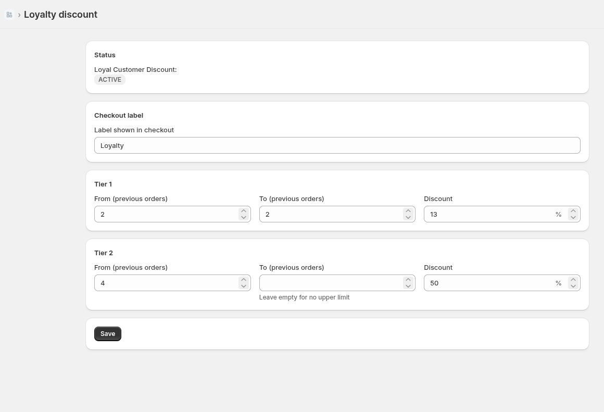
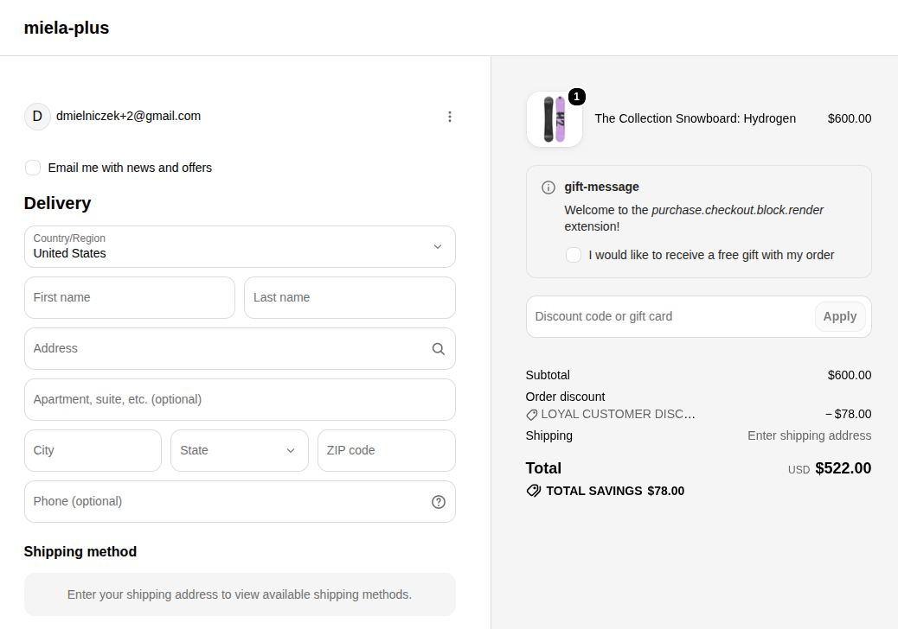
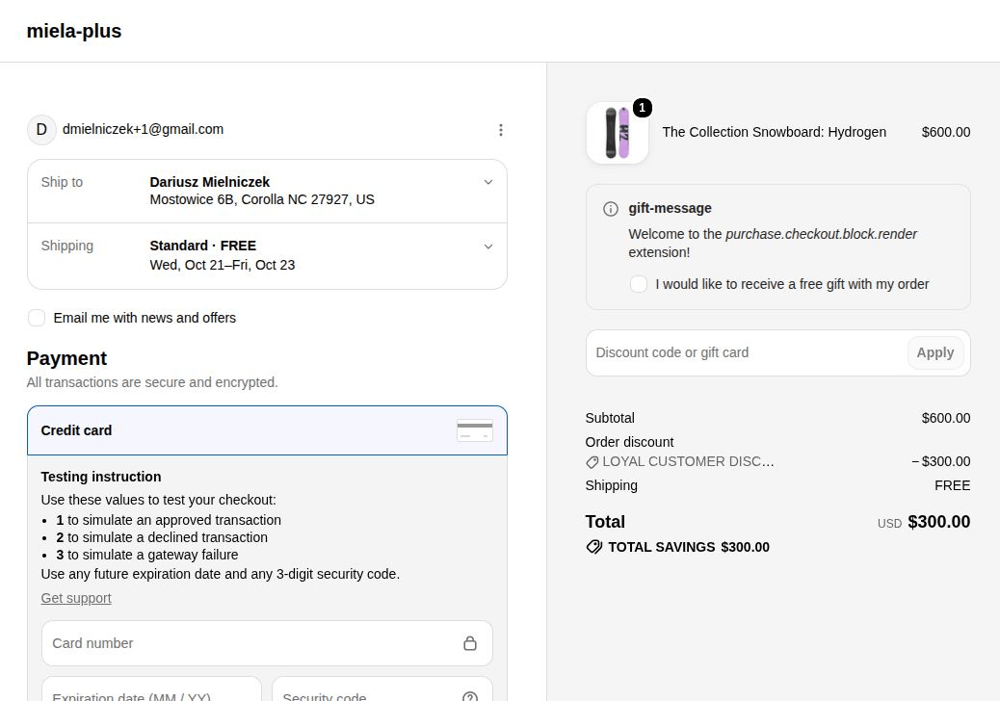
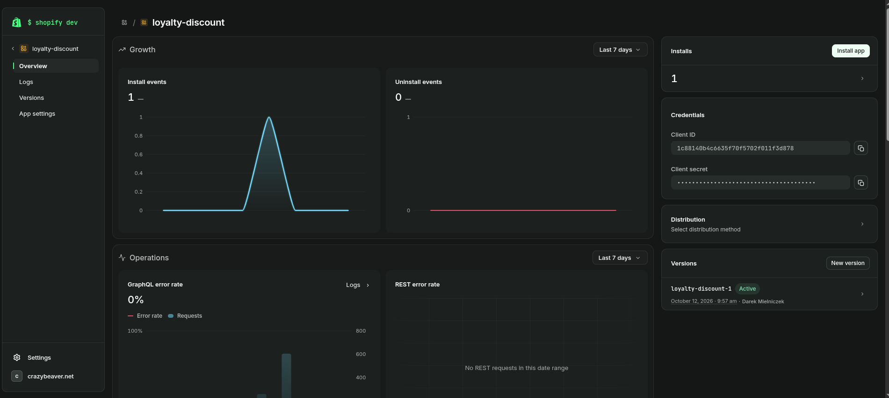

# Shopify Customer Loyalty Discount

## Description
Shopify app with Shopify Functions gives order discount based on logged-in customer's order history. There is ability to set 2 tiers.

Default tiers:
- 2 orders - 13% discount
- 4 or more orders - 50% discount

As was written in task description I intentionally set that customer with exactly 3 orders gets no discount.

Anyway, it could be changed in app dashboard - amount of orders and discount.


## Architecture

1. App uses function `order-history-discount` in JS, target `cart.lines.discounts.generate.run`, compiled to WASM.

2. App dashboard built with React Router and Polaris. It allows to set tiers and discount label. Data are stored in metafield.

3. Function reads metafield in input query. If it doesn't exist, function uses default values from task description.

4. This solution allows store owner to easily change tiers of discount without redeploying the app.

## API Scopes

1. App uses only `write_discounts` scope. It's required for the backend to create the discount (`discountAutomaticAppCreate`) and save in metafield (`metafieldsSet`).
2. Function doesn't need any scope because it gets data from Shopify via input query.
3. `read_orders` is not necessary because `numberOfOrders` is ready in `cart.buyerIdentity.customer`, as well as `read_customers`.
4. Instead of scope app needs access to protected customer data in app settings. Without it `buyerIdentity.customer` always shows `null`.
5. Webhooks from the template (app/uninstalled, app/scopes_update) don't need scope.

## GraphQL and mutations

### Function input query

File: `extensions/order-history-discount/src/cart_lines_discounts_generate_run.graphql`

The task mentions `input.graphql`, but new Shopify CLI names the query file after the function target, so in this repo it's `cart_lines_discounts_generate_run.graphql`.

```graphql
query CartInput {
  cart {
    buyerIdentity {
      customer {
        numberOfOrders
      }
    }
  }
  discount {
    discountClasses
    metafield(namespace: "$app:loyalty-discount", key: "function-configuration") {
      jsonValue
    }
  }
}
```

- `cart.buyerIdentity.customer.numberOfOrders` – number of past orders, for not logged customers `buyerIdentity` and `customer` return `null`. So this checks eligibility for discount (number of orders and if customer is logged in)
- `discount.discountClasses` – function returns discount only if discount has class `ORDER`
- `discount.metafield(...).jsonValue` – getting configuration from dashboard

`cart.lines` are not in the query on purpose. Percentage discount on `orderSubtotal` is calculated by Shopify, so function doesn't need line prices.

### Admin API query (dashboard)

File: `app/routes/app._index.jsx`. Used by the dashboard to find the discount and read its current config.

```graphql
query LoyaltyDiscount {
  shopifyFunctions(first: 25) {
    nodes { id handle }
  }
  discountNodes(first: 50) {
    nodes {
      id
      config: metafield(namespace: "$app:loyalty-discount", key: "function-configuration") {
        jsonValue
      }
      discount {
        ... on DiscountAutomaticApp {
          title
          status
          appDiscountType { functionId }
        }
      }
    }
  }
}
```

- `shopifyFunctions` - finds function ID by handle
- `discountNodes` - gets discount bound with function and reads metafield
- I used `discountNodes` instead of `automaticDiscountNodes` because only the first one returns discounts from functions

### Mutations
- `discountAutomaticAppCreate` - creates discount with metafield if it doesn't exist
- `metafieldsSet` - saves discount data

### Metafield
- namespace `$app:loyalty-discount`, key `function-configuration`, type `json`, owner: discount
- Metafield belongs to our app (`$app:`): other apps don't have access to it

Default configuration looks as below:
```js
const DEFAULT_CONFIG = {
  label: 'Loyal Customer Discount',
  rules: [
    { minOrders: 2, maxOrders: 2, percentage: 13 },
    { minOrders: 4, percentage: 50 },
  ],
};
```

Function validates it and if it gets error, uses `DEFAULT_CONFIG`.

## App Bridge
The app dashboard is embedded in Shopify admin, navigation by `s-app-nav`. I use `shopify.toast.show()` after successful save. The form has `data-save-bar`, so Shopify shows Save/Discard bar when something in the form is changed.

## Validation

Function checks every rule from the metafield:
- `minOrders` - whole number, 0 or more
- `maxOrders` - empty or not lower than `minOrders`
- `percentage` - more than 0 and max 100

If one rule is wrong, the whole config is ignored and `DEFAULT_CONFIG` is used. I didn't want to apply only half of merchant's settings. Empty label means default label.

Dashboard checks the same before saving and also that Tier 1 ends before Tier 2 starts.

## Tests

```bash
cd extensions/order-history-discount
npx vitest run
```

Tests are fixtures in `tests/fixtures`. Every file has function input and expected output. Test runner validates the fixture against the input query and runs the compiled function.

| Fixture | Case | Expected |
|---|---|---|
| `guest.json` | guest, no customer | no discount |
| `one-previous-order.json` | 1 order | no discount |
| `two-previous-orders.json` | 2 orders | 13% |
| `three-previous-orders.json` | 3 orders | no discount |
| `four-previous-orders.json` | 4 orders | 50% |
| `many-previous-orders.json` | 12 orders | 50% |
| `no-orders-class.json` | 2 orders, discount without `ORDER` class | no discount |
| `custom-config.json` | config from metafield, 1 order | 5%, label "VIP" |
| `invalid-config-falls-back.json` | broken config (500%), 2 orders | 13%, default label |

## Installation

Requirements: Node.js 20.19+ or 22.12+, Shopify CLI, Shopify Partners account and development store.

```bash
git clone <repo-url>
cd loyalty-discount
npm install
shopify app dev
```

1. Install the app on dev store using the link from terminal.
2. In app settings turn on access to protected customer data. Without it function sees every customer as a guest.
3. Open the app in Shopify admin and click "Create discount".

### Testing on dev store

Orders placed in checkout with test payment (Bogus Gateway) have `test: true` and are not counted in `numberOfOrders`. I found it when discount didn't show up for customer with 6 orders - Shopify counted 0. Test customers need orders created in admin: Orders → Create order → choose customer → Mark as paid.

Customers I used for demo:
- 2 orders → 13%
- 3 orders → no discount
- 4 orders → 50%

## Limitations / next steps

- `discountNodes(first: 50)` has no pagination. With many discounts it would be better to keep discount ID in database (Prisma is already in the project).
- `DEFAULT_CONFIG` is duplicated in function and dashboard. Function is built separately to WASM and doesn't import app code.
- Dashboard supports exactly 2 tiers, function can handle any number of rules.
- `combinesWith` is hardcoded - discount combines only with shipping discounts.
- During development `shopify app dev` kept showing "Error while polling app logs", so I couldn't see function logs. I debugged with tests and by checking data in Admin API.

## Screenshots





